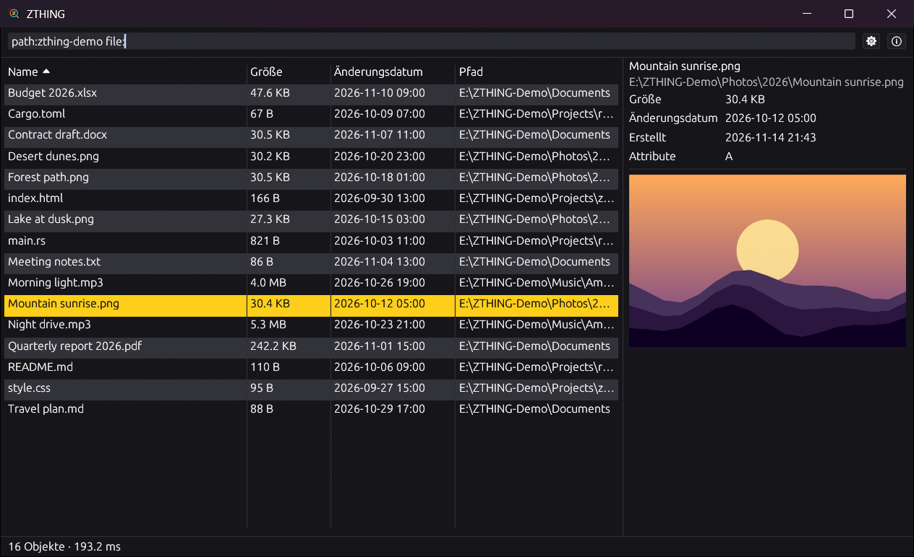
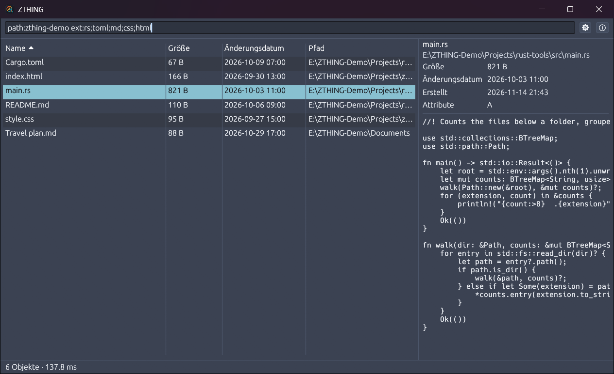
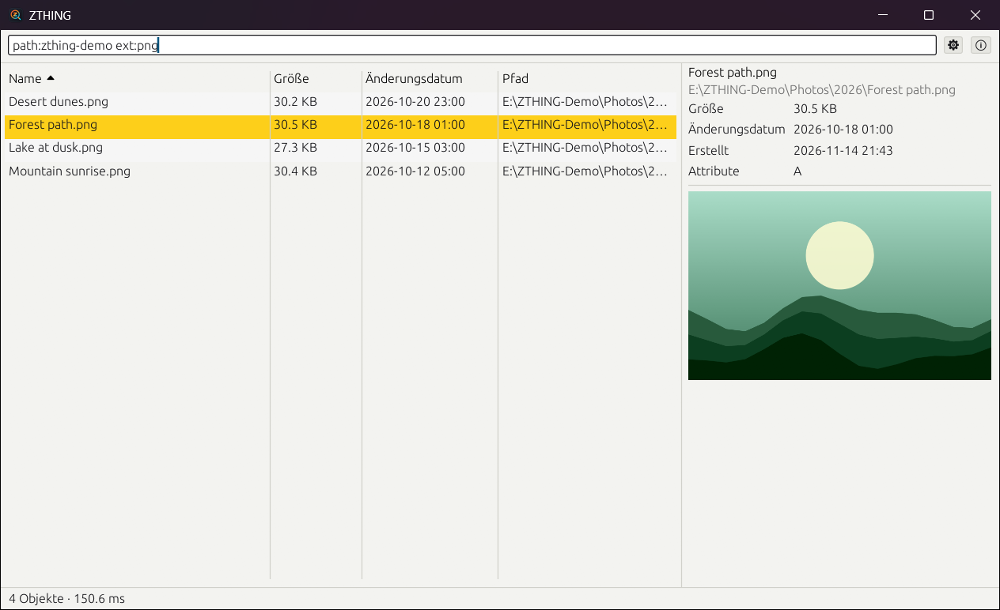
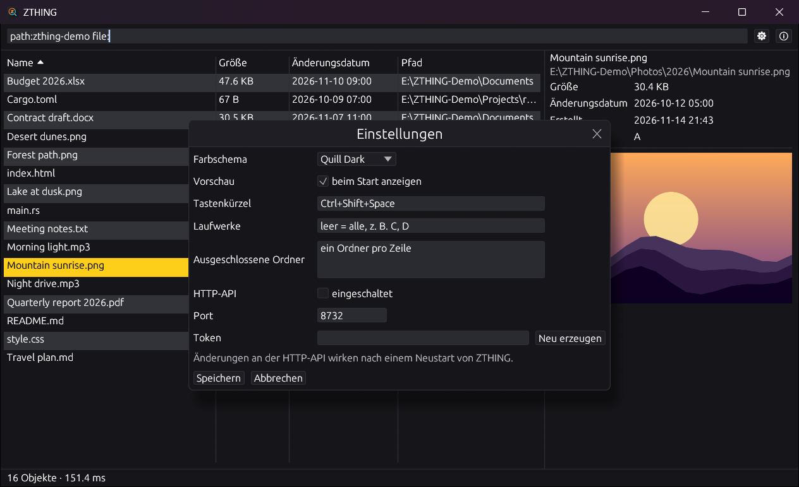
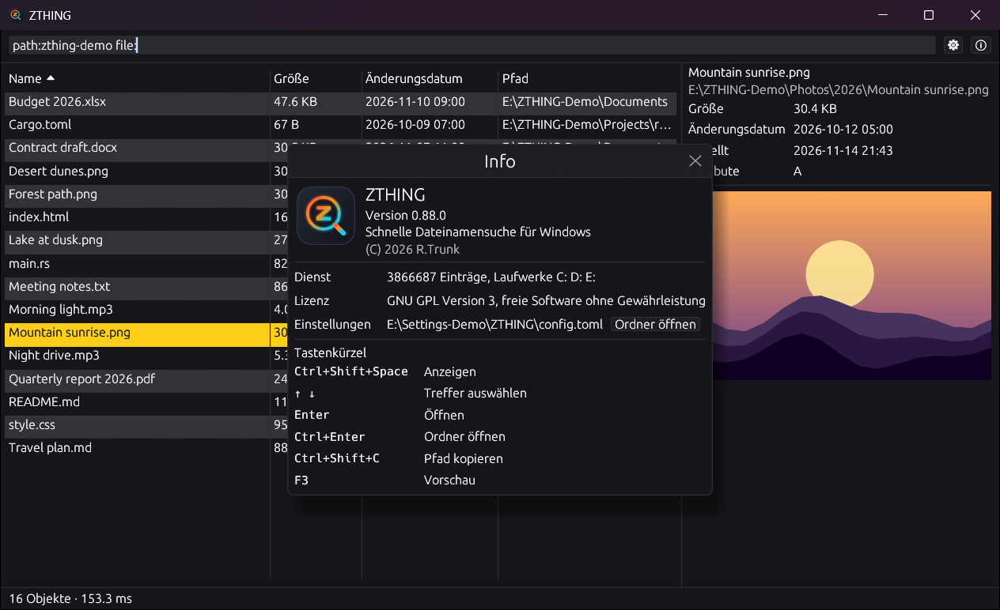

# ZTHING

Schnelle Dateinamensuche für Windows. ZTHING liest die NTFS-Masterdateitabelle
direkt, hält den Index über das USN-Journal aktuell und findet Namen unter
Millionen Dateien, während du tippst.

[English](README.md) · [Projektseite](https://raytrunk.github.io/ZTHING/)



- Eine Suche über 3,8 Millionen Einträge dauert 3 bis 31 ms, die Liste folgt
  also jedem Tastendruck.
- Neue, umbenannte und gelöschte Dateien erscheinen nach etwa einer Sekunde.
- Suchfenster, Kommandozeile `zt`, eine DLL für C, C++ und C#, ein Python-Paket,
  eine optionale HTTP-API und das URL-Protokoll `zthing:` fragen alle denselben
  Windows-Dienst und seinen einen Index.
- Der Dienst blendet Treffer in Ordnern aus, die der anfragende Benutzer nicht
  auflisten darf.

## Installation

Starte `ZTHING-<version>-setup.exe` aus den Releases. Der Installer legt ZTHING
unter `C:\Program Files\ZTHING` ab und registriert den ZTHING-Dienst (dafür sind
einmalig Administratorrechte nötig) sowie das URL-Protokoll `zthing:`. Wahlweise
richtet er den Autostart ein und nimmt `zt` in den PATH auf. Beim ersten Start
liest der Dienst alle lokalen NTFS-Laufwerke ein, das dauert einige Sekunden.

Für eine Einrichtung von Hand enthält das ZIP dieselben Dateien: einmal
`zthing-service.exe install` in einer Administrator-Konsole ausführen, danach
`zthing-gui.exe` starten. `zthing-service.exe uninstall` entfernt den Dienst wieder.

## Das Suchfenster

Einfach lostippen. Leerzeichen verknüpfen Begriffe, `bericht 2026 pdf` findet
also Namen, die alle drei enthalten.

| Taste | Wirkung |
|---|---|
| Alt+Leertaste (einstellbar) | Fenster von überall aufrufen |
| ↑ ↓ | Treffer auswählen |
| Enter, Doppelklick | öffnen |
| Strg+Enter | Ordner öffnen, Datei markiert |
| Strg+Umschalt+C | Pfad kopieren |
| F3 | Vorschau ein- oder ausblenden |
| Rechtsklick | Öffnen mit, Terminal hier, Name kopieren, Eigenschaften |

Bei Textdateien zeigt die Vorschau den Inhalt, bei allen anderen das Bild aus
dem Explorer: Vorschaubilder von Bildern, Videos und Dokumenten, sonst das
Symbol. Cloud-Platzhalter wie OneDrive-Dateien auf Abruf werden für die Vorschau
nie heruntergeladen.

Das Zahnrad öffnet die Einstellungen: Farbschema (die Quill-Themes und weitere),
Vorschau, Tastenkürzel, zu durchsuchende Laufwerke, ausgeschlossene Ordner und
die HTTP-API. Sie liegen in `%APPDATA%\ZTHING\config.toml`. Nach dem
Schließen des Fensters läuft ZTHING im Infobereich weiter; erst *Beenden* im
Tray-Menü beendet es.

| | |
|---|---|
|  |  |
|  |  |

## Suchsyntax

| Eingabe | Findet |
|---|---|
| `foo bar` | Namen mit `foo` und `bar` |
| `foo\|bar` | `foo` oder `bar` |
| `!foo` | Namen ohne `foo` |
| `"meine datei"` | die Phrase mit Leerzeichen |
| `*.iso`, `bericht??.pdf` | Platzhalter |
| `regex:^IMG_\d+\.jpe?g$` | regulärer Ausdruck |
| `ext:pdf;docx` | Dateiendungen |
| `path:windows\system32` | Vergleich mit dem ganzen Pfad |
| `file:`, `folder:` | nur Dateien oder nur Ordner |
| `size:>10mb` | Größe, auch `<`, `>=`, `<=`, Einheiten kb mb gb tb |
| `dm:today`, `dm:2026-01-01..2026-03-31` | Änderungsdatum |
| `case:Readme` | Groß-/Kleinschreibung beachten |

## Kommandozeile

```
zt [--json] [--count] [--limit N] [--sort name|path|size|dm] <suche>
```

`zt "*.iso"` gibt einen Pfad pro Zeile aus, `--json` Treffer mit Größe und Datum.
Mit Treffern endet `zt` mit Exit-Code 0, ohne Treffer mit 1, bei Fehlern mit 2.

## Für Entwickler

[docs/API.md](docs/API.md) beschreibt alle Schnittstellen (auf Englisch): das
Named-Pipe-Protokoll, `zthing.dll` mit `zthing.h`, das Python-Paket,
`zt --json`, die HTTP-API und das URL-Protokoll. Lauffähige Beispiele in C, C#
und Python liegen unter [examples](examples).

## Bauen

Benötigt Rust 1.88 oder neuer mit der MSVC-Toolchain unter Windows 10 oder 11.

```
cargo build --release --workspace
cargo test --workspace
```

`installer\package.ps1` baut den Release-Ordner, das ZIP und, wenn Inno Setup 6
installiert ist, den Installer. Es signiert die Dateien, wenn `ZTHING_SIGN_PFX`
und `ZTHING_SIGN_PASSWORD` ein Codesignatur-Zertifikat angeben.

| Crate | Aufgabe |
|---|---|
| `zthing-core` | Index, Query-Parser, Suche |
| `zthing-ntfs` | $MFT lesen, USN-Journal, Index speichern |
| `zthing-service` | Windows-Dienst und Named-Pipe-Server |
| `zthing-client` | Client für die Pipe, von allen anderen genutzt |
| `zthing-gui` | Suchfenster |
| `zthing-cli` | `zt` |
| `zthing-ffi` | `zthing.dll` |

## Gemessen

Auf dem Entwicklungsrechner mit drei NTFS-Laufwerken (3,84 Millionen Einträge
einschließlich Hardlinks):

| Was | Ergebnis |
|---|---|
| Laufwerke einlesen (warmer Cache) | C: 2,7 s, D: 4,8 s, E: 2,3 s |
| Suche im Index | 3 bis 31 ms |
| `zt` über den Dienst, mit Programmstart | etwa 42 ms |
| Änderung im Index sichtbar | 2 bis 17 ms nach dem Journal-Eintrag |
| Speicher des Suchfensters | etwa 81 MB (der Index liegt im Dienst) |

## Lizenz

(C) 2026 R.Trunk

ZTHING ist freie Software: Du kannst sie unter den Bedingungen der GNU General
Public License Version 3, wie von der Free Software Foundation veröffentlicht,
weitergeben und verändern. Sie wird in der Hoffnung verbreitet, dass sie nützlich
ist, aber OHNE JEDE GEWÄHRLEISTUNG, sogar ohne die implizite Gewährleistung der
MARKTREIFE oder der EIGNUNG FÜR EINEN BESTIMMTEN ZWECK. Der vollständige Text
steht in [LICENSE](LICENSE); rechtlich gilt die englische Fassung.
