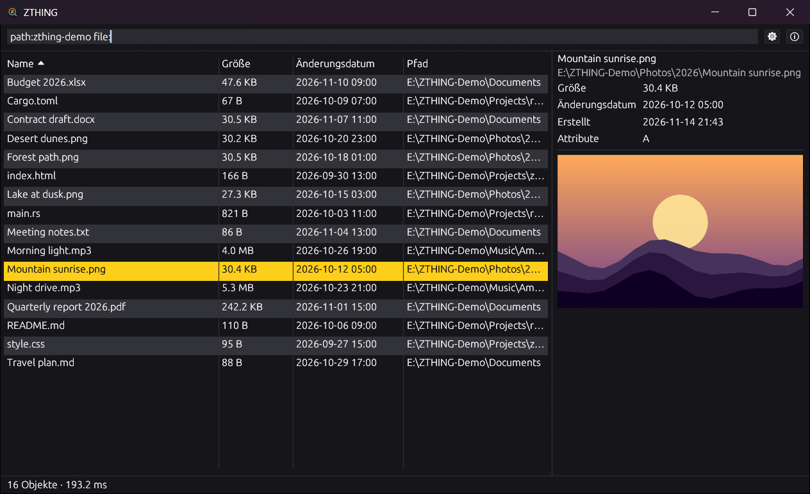
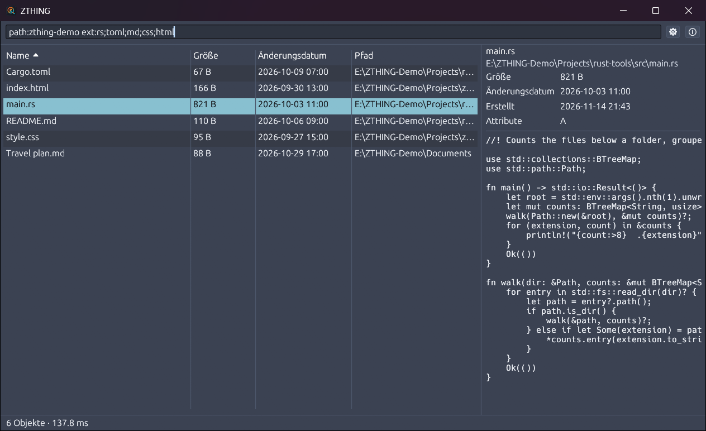
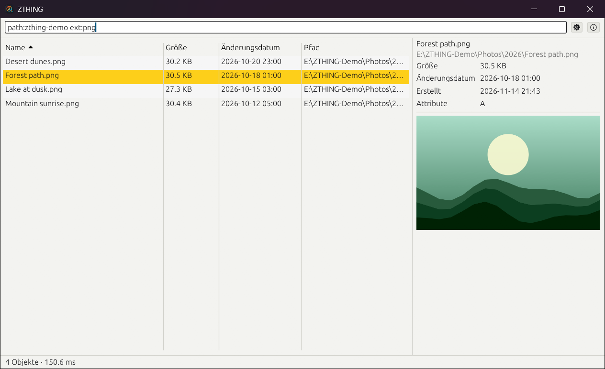
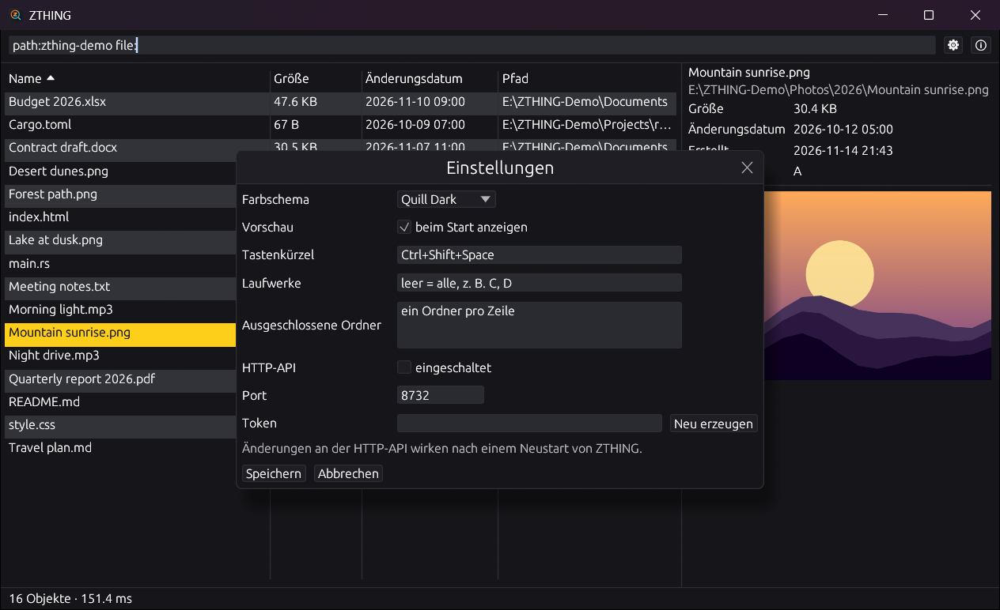
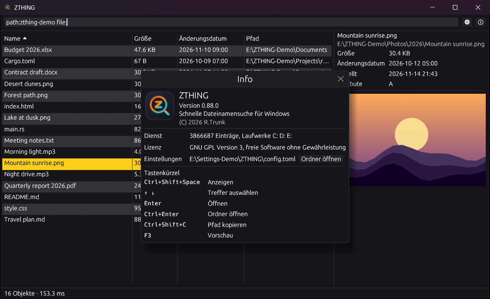

# ZTHING

Fast file name search for Windows. ZTHING reads the NTFS master file table
directly, keeps the index current through the USN journal and finds names among
millions of files while you type.

[Deutsch](README.de.md) · [Project page](https://raytrunk.github.io/ZTHING/)



- Results while typing: a search over 3.8 million entries takes 5 to 30 ms.
- Always current: new, renamed and deleted files show up within about a second.
- One index for everything: the search window, the command line `zt`, a DLL for
  C, C++ and C#, a Python package, an optional HTTP API and the URL protocol
  `zthing:` all ask the same Windows service.
- Users only see what they may open: the service hides hits in folders the
  asking user cannot list.

## Install

Run `ZTHING-<version>-setup.exe` from the releases. It installs to
`C:\Program Files\ZTHING`, registers the ZTHING service (administrator rights are
needed once for that), the URL protocol `zthing:` and optionally autostart and
`zt` on the PATH. The service reads all local NTFS drives on its first start,
which takes a few seconds.

The ZIP contains the same files for a manual setup: run
`zthing-service.exe install` once in an administrator console, then start
`zthing-gui.exe`. `zthing-service.exe uninstall` removes the service again.

## The search window

Type to search. Spaces combine terms, so `report 2026 pdf` finds names that
contain all three.

| Key | Action |
|---|---|
| Alt+Space (configurable) | show the window from anywhere |
| ↑ ↓ | select a hit |
| Enter, double click | open |
| Ctrl+Enter | open the folder with the file selected |
| Ctrl+Shift+C | copy the path |
| F3 | show or hide the preview |
| right click | open with, terminal here, copy name, properties |

The preview pane shows text files, and for other files the picture Explorer
shows: thumbnails of images, videos and documents, otherwise the icon. Cloud
placeholders such as OneDrive files on demand are never downloaded for a preview.

The gear button opens the settings: colour theme (the Quill themes and others),
preview, shortcut, drives to search, excluded folders and the HTTP API. They are
stored in `%APPDATA%\ZTHING\config.toml`. Closing the window keeps ZTHING in the
tray; *Quit* in the tray menu ends it.

| | |
|---|---|
|  |  |
|  |  |

## Query syntax

| Input | Matches |
|---|---|
| `foo bar` | names containing `foo` and `bar` |
| `foo\|bar` | `foo` or `bar` |
| `!foo` | names without `foo` |
| `"my file"` | the phrase including the space |
| `*.iso`, `report??.pdf` | wildcards |
| `regex:^IMG_\d+\.jpe?g$` | regular expression |
| `ext:pdf;docx` | extensions |
| `path:windows\system32` | match against the full path |
| `file:`, `folder:` | only files or only folders |
| `size:>10mb` | size, also `<`, `>=`, `<=`, units kb mb gb tb |
| `dm:today`, `dm:2026-01-01..2026-03-31` | date modified |
| `case:Readme` | case-sensitive |

## Command line

```
zt [--json] [--count] [--limit N] [--sort name|path|size|dm] <query>
```

`zt "*.iso"` prints one path per line, `--json` prints hits with size and date.
The exit code is 0 with matches, 1 without and 2 on errors.

## For developers

[docs/API.md](docs/API.md) describes all interfaces: the named pipe protocol,
`zthing.dll` with `zthing.h`, the Python package, `zt --json`, the HTTP API and
the URL protocol. Runnable examples in C, C# and Python are in
[examples](examples).

## Building

Needs Rust 1.88 or newer with the MSVC toolchain on Windows 10 or 11.

```
cargo build --release --workspace
cargo test --workspace
```

`installer\package.ps1` builds the release folder, the ZIP and, with Inno Setup 6
installed, the installer. It signs the files when `ZTHING_SIGN_PFX` and
`ZTHING_SIGN_PASSWORD` name a code signing certificate.

| Crate | Purpose |
|---|---|
| `zthing-core` | index, query parser, search |
| `zthing-ntfs` | reading the $MFT, USN journal, saving the index |
| `zthing-service` | Windows service and named pipe server |
| `zthing-client` | client for the pipe, used by everything else |
| `zthing-gui` | search window |
| `zthing-cli` | `zt` |
| `zthing-ffi` | `zthing.dll` |

## Measured

On the development machine with three NTFS drives (3.84 million entries
including hard links):

| What | Result |
|---|---|
| Reading the drives (warm cache) | C: 2.7 s, D: 4.8 s, E: 2.3 s |
| Search in the index | 3 to 31 ms |
| `zt` through the service, including start | about 42 ms |
| Change visible in the index | 2 to 17 ms after the journal entry |
| Search window memory | about 81 MB (the index lives in the service) |

## License

(C) 2026 R.Trunk

ZTHING is free software: you can redistribute it and/or modify it under the
terms of the GNU General Public License version 3 as published by the Free
Software Foundation. It is distributed in the hope that it will be useful, but
WITHOUT ANY WARRANTY; without even the implied warranty of MERCHANTABILITY or
FITNESS FOR A PARTICULAR PURPOSE. See [LICENSE](LICENSE) for the full text.
